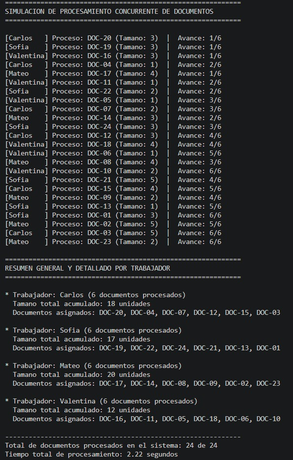
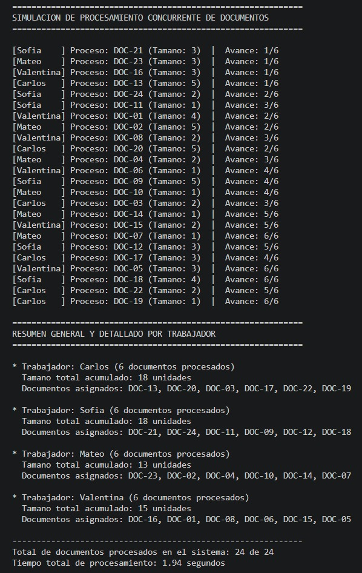
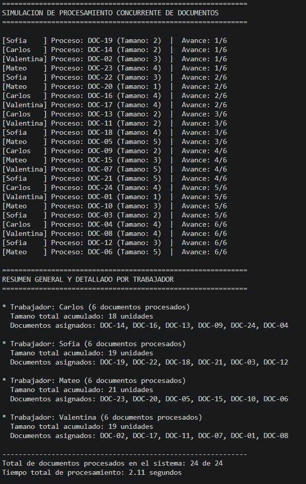
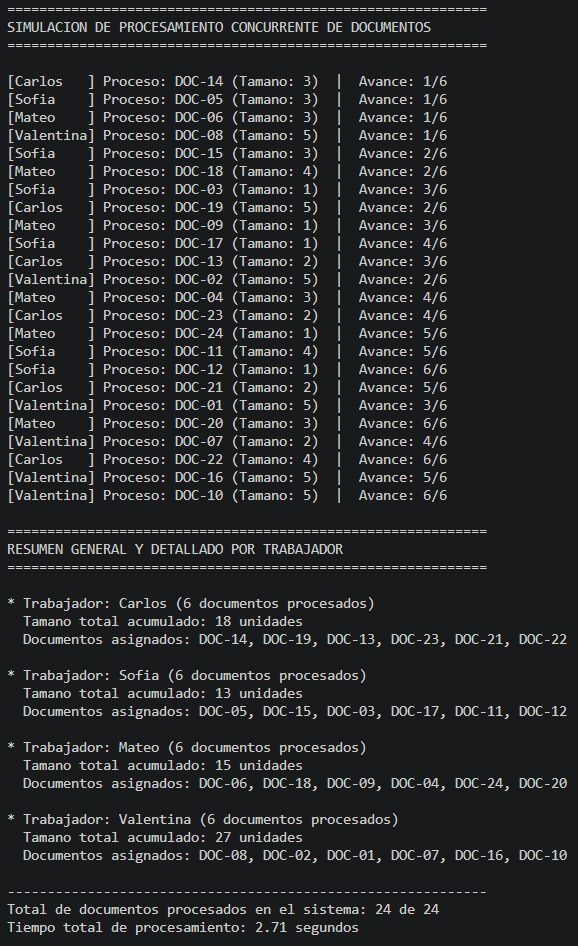

# Practica 1: Hilos, Concurrencia y Sincronizacion en Sistemas Operativos

---

## 1. Descripcion 

Este programa simula un sistema de procesamiento de archivos donde un conjunto de 24 documentos debe ser clasificado y procesado por 4 trabajadores concurrentes (Carlos, Sofia, Mateo y Valentina), representados como hilos (threading.Thread).

### Como funciona 

1. **Generacion y mezcla de documentos:** Se crean 24 documentos con un identificador unico (DOC-01 a DOC-24) y un tamano simulado al azar entre 1 y 5. Antes de iniciar la ejecucion, la lista de documentos se desordena con random.shuffle() para asegurar que en cada corrida la asignacion sea totalmente diferente.
2. **Cola de trabajo compartida (queue.Queue):** Los documentos mezclados se insertan en una cola global de la cual los 4 hilos van retirando tareas de forma dinamica a medida que se liberan.
3. **Control y equidad:** Para mantener un balance de carga parejo entre todos los hilos, cada trabajador tiene una cuota fija de maximo 6 documentos (24 / 4 = 6).
4. **Simulacion de tiempo:** El tiempo que tarda un hilo en procesar un documento depende directamente de su tamano (time.sleep(tamano * 0.1)).
5. **Sincronizacion:** Cuando un hilo termina de procesar un documento, utiliza un Lock (lock_global) para actualizar el registro compartido sin interferir con la memoria de los otros hilos.

---

## 2. Evidencias de Ejecucion

 se muestra 4 ejecuciones independientes del programa. En cada una de ellas se demuestra el dinamismo del sistema: el orden y los documentos asignados a cada trabajador cambian, pero siempre se garantiza que cada uno procese exactamente 6 documentos y se completen los 24 en total.

| N° Ejecucion | Captura de Pantalla |
| :---: | :--- |
| **Ejecucion 1** |  |
| **Ejecucion 2** |  |
| **Ejecucion 3** |  |
| **Ejecucion 4** |  |

---

## 3. Preguntas 

### 1. ¿Por que queue.Queue es apropiada para compartir trabajos?
Porque queue.Queue es una estructura de datos Thread-Safe (segura para hilos). Esto significa que implementa bloqueos de sincronizacion internos automaticamente, lo que permite que multiples hilos consulten o extraigan elementos al mismo tiempo (get_nowait()) sin riesgo de que dos trabajadores tomen exactamente el mismo documento o corrompan la cola en memoria.

### 2. ¿Que protege Lock y que pasaria si se actualizara el resumen sin el?
El Lock (lock_global) protege la seccion critica de nuestro programa, que es el diccionario compartido registro_trabajadores. 

Si actualizaramoss ese diccionario sin el Lock, se me presentaria una condicion de carrera (Race Condition). Esto pasa porque dos o mas hilos podrian intentar leer, modificar y guardar el conteo al mismo tiempo en la memoria, haciendo que unas escrituras sobrescriban a las otras y resultando en un conteo final incorrecto (menos de 24 documentos).

### 3. ¿Que cambiarias si cada documento tuviera que guardarse en un archivo real?
* **En la funcion del trabajador:** En lugar de simular la espera con time.sleep(), colocariamos codigo real de Entrada/Salida (I/O) utilizando bloques with open(filename, "w") as f: para escribir los datos en el disco.
* **En el manejo del Lock:** 
  * Si cada hilo escribe en su propio archivo independiente por documento, no se necesita el Lock para la escritura, aprovechando al maximo la velocidad de la concurrencia.
  * Si todos los trabajadores tienen que escribir sus avances dentro de un unico archivo de registro o log central, seria obligatorio usar un Lock al momento de escribir en ese archivo para evitar que los textos de los diferentes hilos se me mezclen o corrompan el archivo.

---

## 4. Reto Adicional

* **Medicion de Tiempo:** Se integro la libreria time para registrar el tiempo total transcurrido en la simulacion concurrente (desde el inicio hasta que el ultimo hilo finaliza en el join()).
* **Acumulado por Tamano:** El reporte final contabiliza tanto la cantidad de documentos procesados por trabajador como la suma total del tamano simulado de sus archivos.
* **Concurrencia vs Secuencial:** Al trabajar con tareas donde la CPU espera por operaciones simuladas (como I/O o red), la ejecucion multihilo permite aprovechar el tiempo de espera de un hilo para que los demas sigan procesando, reduciendo el tiempo total frente a una ejecucion secuencial.
